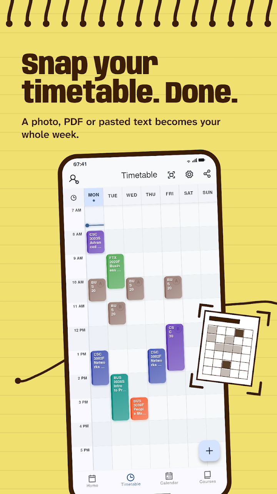
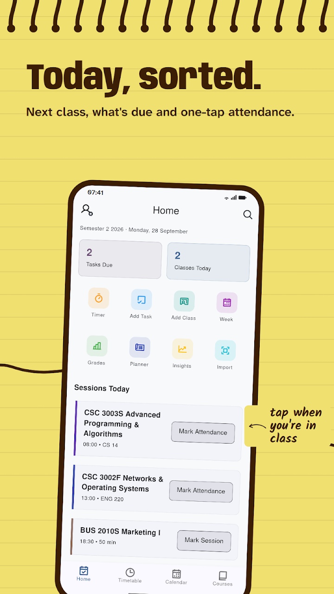
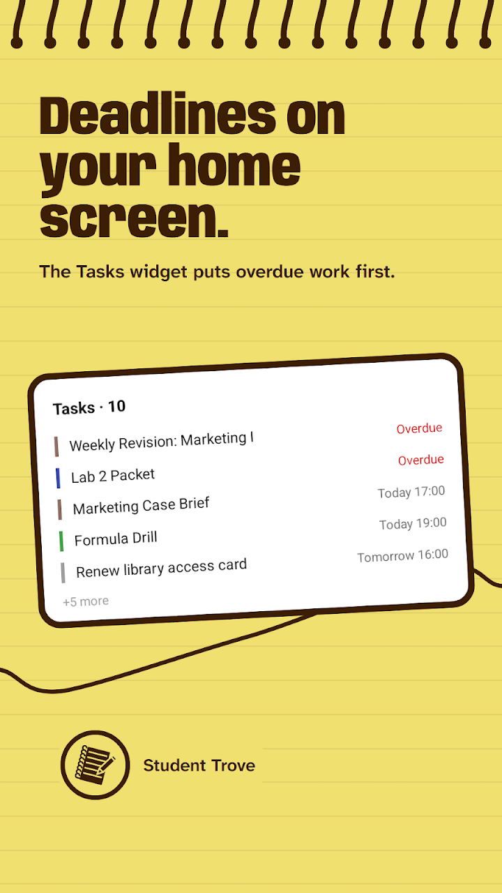
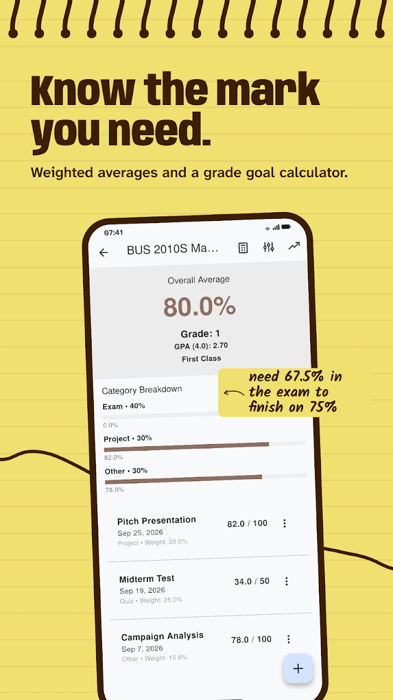
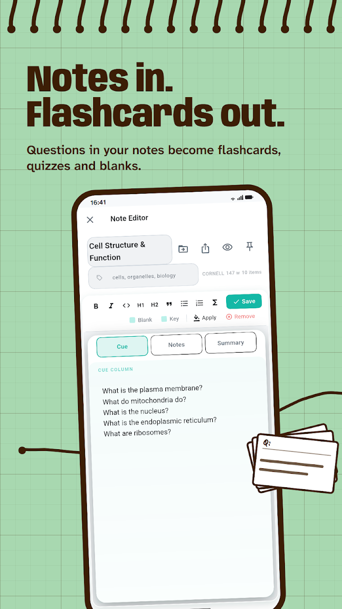
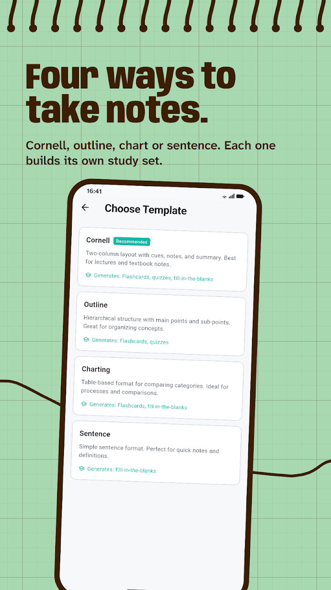
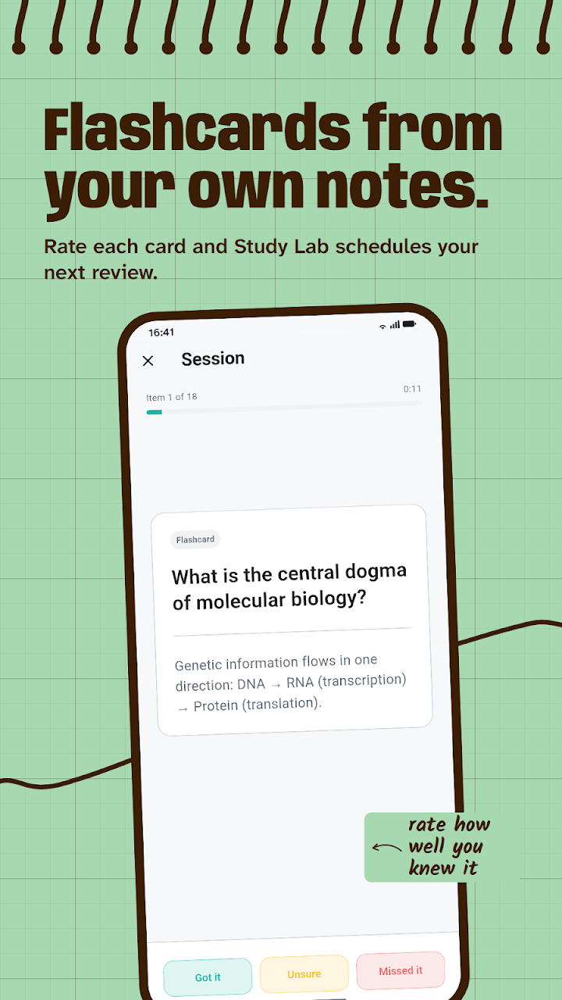
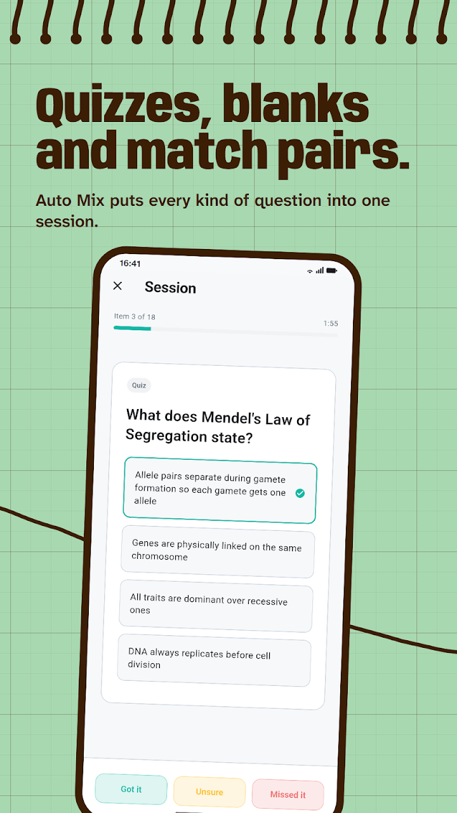

# Student Trove

**Two study apps for students, shipped on Google Play and the web** ([Study Planner](https://studenttrove.co.za/planner/) · [Study Lab](https://studenttrove.co.za/lab/)).
A planner that runs your semester, and a study lab that turns your notes into practice.

**Study Planner: ★ 4.8 on Google Play · nearly 4,000 downloads** (Play Console)

> This repo is the public showcase. The app source is private because it's a live commercial
> product, but I'm happy to walk through the code and architecture in an interview.

---

## Study Planner

*An all-in-one academic planner: timetable, tasks, grades and attendance in one focused app.*

  
  
  
  

- **Smart Import:** photograph a printed timetable, or drop in a PDF or pasted text. Classes, tasks,
  grades and courses are extracted, and you review them before they're saved.
- **Timetable that fits real universities:** semesters, conflict detection, and Week A / Week B
  schedules that resolve automatically from an anchor date.
- **Tasks and calendar:** due times, multiple reminders with snooze, recurring tasks with
  per-occurrence edits, task dependencies with auto-reschedule, and ICS/CSV import/export.
- **Attendance with absence limits:** set the absences each subject allows, see your rate, and get
  warned before you run out, including what one more absence would do.
- **Grades and GPA:** weighted categories, several grading systems, and what-if projections.
- **Accessible by default:** four colour-vision palettes, high contrast, text scaling and reduce-motion.

## Study Lab

*Write your notes once and Study Lab turns them into a full study toolkit.*

  
  
  
  

- **Four note templates:** Cornell, outline, charting and sentence, each matched to a type of material.
- **Auto-generated practice:** flashcards, multiple-choice quizzes, fill-in-the-blanks and match
  pairs, built straight from what you wrote.
- **Smart sessions:** Auto Mix rotates question types, tracks confidence live and prioritises what
  you struggle with.
- **Mistake bank and mastery scores:** missed items come back in later sessions, and per-subject
  mastery shows what to study next.

## Product decisions

- **Built for how students actually study:** rotating timetables, absence limits and what-if grade
  maths cover the cases most planners ignore.
- **Remove the setup wall.** Typing in a whole semester is where planners lose people, so
  Smart Import turns a photo, PDF or pasted text into classes and tasks in one step.
- **Freemium:** the core planner is free. Premium adds Smart Import (with one free import to
  try it), advanced insights, the workload heatmap and the study-session planner.

## How it's built

| | Study Planner | Study Lab |
|---|---|---|
| Framework | Flutter | Flutter |
| Architecture | Clean Architecture (domain / data / presentation) | Three-layer, feature-first |
| State | Provider + GetIt | Riverpod |
| Storage | Drift (SQLite) with SQLCipher encryption, JSON backup/restore | SQLite |
| Notable | Smart Import (photo/PDF/text → structured data), local notifications, ICS/CSV | AppFlowy rich-text editor, study-item generation engine, go_router |
| Services | Supabase (sync, remote config), RevenueCat (subscriptions) | Supabase (entitlement sync), RevenueCat (subscriptions) |
| Platforms | Android, web | Android, web |

---

Built by **Keegan Joubert** · [GitHub](https://github.com/britishtable)
